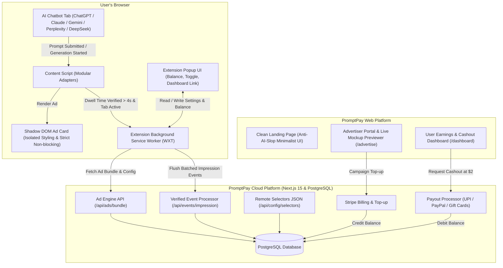

# Research: Architecture Overview for PromptPay

**Domain:** Browser Extension Monetization & AI Inline Ad Network
**Status:** Approved

---

## High-Level Architecture Diagram

---

## Data Flow & Anti-Fraud Sequence

1. **Generation Trigger**:
   - The user types a query in ChatGPT, Claude, Gemini, Perplexity, or DeepSeek and hits Send/Enter.
   - The site-specific adapter content script captures the submit event during the capture phase (before the host page clears the composer).

2. **Ad Retrieval & Rendering**:
   - The extension pulls an eligible creative from the locally cached ad bundle (pre-fetched from `/api/ads/bundle`).
   - If no direct advertiser campaign matches targeting, an affiliate fallback card (e.g., Cursor, Perplexity Pro, Notion) is rendered.
   - The ad card is injected directly into a newly attached open Shadow DOM wrapper immediately adjacent to the user message turn.

3. **Active Dwell-Time Verification**:
   - An internal timer monitors the ad container.
   - It verifies:
     - `document.visibilityState === 'visible'` (tab is in active foreground).
     - Window has focus.
     - The ad has been visible for at least 4 contiguous seconds while the chatbot model streams or thinks.
   - If the user switches tabs, closes the window, or hits "×" (dismiss) before 4 seconds, the impression is discarded.

4. **Event Batching & Settlement**:
   - Qualified impressions are queued in `browser.storage.local`.
   - The background worker flushes queued impressions to `/api/events/impression` periodically or on tab idle.
   - The backend validates the cryptographically signed `ad_token`, debits the advertiser's campaign balance, credits 60% of the CPM rate to the user's ledger, and flags 10% referral credits to the referrer if applicable.
