# AGENTS.md — Master Multi-Agent Operational Contract & SPOC

> **SINGLE POINT OF CONTACT (SPOC) & SUPREME OPERATIONAL DIRECTIVE**  
> **Target Audience:** All AI Coding Agents, Antigravity Swarm Workers, Subagents (UI, Home, Backend, Extension, QA, Marketing), and Human Contributors.  
> **Status:** Active & Universally Enforced.  
> **Supreme Directive:** **THERE IS NO SUCH THING AS "RAPID PROTOTYPING" OR "STUDENT-TIER DEVELOPMENT" IN THIS REPOSITORY. EVERY AGENT AND CONTRIBUTOR BUILDS SUBSTANTIAL, PRODUCTION-READY, INDUSTRIAL INFRASTRUCTURE DESIGNED FOR UNBOUNDED USERS. READ THIS FILE BEFORE PLANNING OR MODIFYING ANY CODE. UPDATE DOCUMENTATION WHENEVER AN ARCHITECTURAL CHANGE IS MADE.**
>
> *(Reference: See [SUBSTANTIAL_DEVELOPMENT.md](./SUBSTANTIAL_DEVELOPMENT.md) for the complete engineering manifesto)*.

---

## 0. THE PARAMOUNT LAW: SUBSTANTIAL DEVELOPMENT ONLY

AI agents are natively biased toward rapid prototyping—cutting corners, omitting error states, stubbing mock APIs with fragile assumptions, skipping defensive boundaries, and producing transient toys.

**That behavior is categorically banned in this codebase.**

When making any decision, refactoring, or building any feature:
1. **Never build for "rapid demo" or "prototype":** Every change must be engineered for enterprise production readiness.
2. **Handle Every Edge Case:** Implement full error boundaries, loading states, rate-limiting, and validation.
3. **No Slop or Placeholders:** Never commit temporary shortcuts, loose `any` typings, or unverified stubbing.
4. **Permanent Industrial Quality:** The platform handles real money, bank payouts, and high-frequency ad impressions. Code quality must be bank-grade.

---

## 1. Executive Problem & Objective

When multiple AI agents or autonomous sessions operate concurrently across this monorepo without a single source of truth, **drift and regressions occur**:
- Layouts get stretched or distorted.
- Authentication barriers are accidentally removed for "convenience".
- AI-slop copy, obscure developer jargon, or bloated text creep into the UI.
- Critical platform invariants (revenue splits, $2.00 cashout floor, Shadow DOM isolation) are compromised.

This document serves as the **Single Point of Contact (SPOC)**. It defines strict domain boundaries, the authoritative user journey, immutable system invariants, and an explicit **"WHAT NEVER TO DO"** anti-pattern checklist.

---

## 2. The Core Architecture & User Flow

### 2.1 The Fundamental Question: "If someone has not logged in, how can they access the dashboard?"

**Answer: THEY CANNOT AND MUST NEVER ACCESS THE DASHBOARD.**  
A private financial rewards dashboard with live payout rails (UPI, PayPal, Gift Cards) and a unique permanent referral link **must never be accessible without verified authentication**.

#### The 3 Authoritative User Journeys:

```mermaid
flowchart TD
    subgraph Flow_1["Flow 1: Extension-Led (Product First)"]
        A1["User installs Chrome Extension"] --> A2["Extension generates anonymous device_id"]
        A2 --> A3["User prompts AI (ChatGPT/Claude)<br/>Sees sponsored card, earns wait-time cents"]
        A3 --> A4["User clicks 'Open Dashboard' in popup"]
        A4 --> A5["Web route gates: /dashboard?device_id=..."]
        A5 --> A6["Redirected to /login"]
        A6 --> A7["User logs in with Google or Email"]
        A7 --> A8["Backend atomically links device_id to email<br/>Dashboard unlocks with earnings!"]
    end

    subgraph Flow_2["Flow 2: Web-Led (Organic / Marketing First)"]
        B1["Visitor lands on pathixorewards.com"] --> B2["Navbar shows 'Sign in' (Dashboard is HIDDEN)"]
        B2 --> B3["User explores features & calculator"]
        B3 --> B4["Clicks 'Sign in'"]
        B4 --> B5["Logs in with Google or Email"]
        B5 --> B6["Navbar dynamically displays 'Dashboard'"]
        B6 --> B7["Enters /dashboard, grabs referral link,<br/>installs extension to link device"]
    end

    subgraph Flow_3["Flow 3: Direct URL Edge Case (Incognito / Bookmark)"]
        C1["Unauthenticated user opens /dashboard"] --> C2["Client & Route Guard trigger before render"]
        C2 --> C3["Zero console/metrics exposure"]
        C3 --> C4["Instant redirect to /login?redirect=/dashboard"]
        C4 --> C5["User signs in -> Lands on Dashboard"]
    end
```



### 2.2 Why Unauthenticated Dashboard Access Is Forbidden:
1. **Identity & Ledger Integrity:** A dashboard tracks real money. A guest has no legal or database identity; paying unauthenticated requests would lead to instant click-farm fraud.
2. **Permanent Unique Referral Link:** Every referral link must be mathematically or cryptographically bound to a user's verified identity (`email`), ensuring it never resets when local browser storage is cleared.
3. **Multi-Device Sync:** Accounts allow a user's laptop, desktop, and work machine to aggregate earnings under one payout threshold.

---

## 3. Subsystem Ownership & Multi-Agent Roster

Every agent operating in this repository must adopt one of the following specialized roles and respect domain boundaries:

```
┌────────────────────────────────────────────────────────────────────────┐
│                        AGENT 0: ORCHESTRATOR / SPOC                    │
│            Enforces AGENTS.md, manages cross-agent dependencies        │
└──────────────────┬─────────────────────────────────┬───────────────────┘
                   │                                 │
         ┌─────────┴─────────┐             ┌─────────┴─────────┐
         │   FRONTEND SQUAD  │             │   BACKEND & EXT   │
         └─────────┬─────────┘             └─────────┬─────────┘
    ┌──────────────┴──────────────┐     ┌────────────┴─────────────┐
    ▼                             ▼     ▼                          ▼
[AGENT 1: UI / DESIGN]   [AGENT 2: WEB/HOME] [AGENT 3: CORE/AUTH] [AGENT 4: EXTENSION]
Tailwind, Spacing,       Landing, Navbar,    Auth, Dashboard,     WXT, Adapters,
Colors, No-AI-Slop       Calculator, Mockups DB, Cashout, Referrals Shadow DOM, MV3
```

### Agent 1: UI & Design System Bot
- **Owns:** `apps/web/app/globals.css`, Tailwind theme tokens, typography, visual hierarchy, mobile drawers.
- **Color Palette:**
  - Background Primary: `#070a0e` (Dark navy slate)
  - Card / Panel Surface: `#0d121c` / `#0c1219`
  - Subtle Borders: `#162534` / `rgba(30, 41, 59, 0.8)`
  - Primary Accent & Highlights: Emerald `#10b981` / Mint `#10e599`
  - Text: Heading White `#ffffff`, Body Slate `#94a3b8`, Muted `#64748b`
- **Container Rules:** Desktop maximum width is strictly clamped to `max-w-6xl` (1152px) or `max-w-7xl` with proper horizontal centering (`mx-auto`). No horizontal stretching across ultra-wide monitors.

### Agent 2: Web & Homepage Bot
- **Owns:** `apps/web/app/page.tsx`, `Navbar.tsx`, `Footer.tsx`, `HeroChatMockup.tsx`, `EarningsCalculator.tsx`, `LiveImpressionCounter.tsx`.
- **Navbar Rules:**
  - The `Dashboard` link beside `Add to Chrome` is **ONLY visible when logged in**.
  - When unauthenticated, show `Sign in` (pointing to `/login`).
  - Mobile hamburger drawer must mirror this exact behavior.

### Agent 3: Auth & Dashboard Console Bot
- **Owns:** `apps/web/app/dashboard/page.tsx`, `apps/web/app/dashboard/referrals/page.tsx`, `apps/web/app/login/page.tsx`, `apps/web/lib/user-store.ts`, `apps/web/lib/referral-engine.ts`.
- **Invariants:**
  - `/dashboard` and `/dashboard/referrals` are **strictly auth-gated**. Unauthenticated visits redirect to `/login`.
  - Header displays user email and a working `Sign out` action that clears `pathixo_auth_session` and dispatches `pathixo_auth_change`.
  - Referral codes are permanent and tied to user email.

### Agent 4: Browser Extension Bot
- **Owns:** `apps/extension/` (WXT Manifest V3, background worker, popup, content scripts, and chatbot adapters).
- **Invariants:**
  - Isolated Shadow DOM (`attachShadow({ mode: 'open' })`) with pure DOM APIs (`document.createElement`, `textContent`). **Zero `innerHTML` sinks.**
  - 4-second minimum dwell timer with `document.visibilityState === 'visible'`.
  - Adapters for ChatGPT, Claude, Gemini, Perplexity, DeepSeek.
  - Ads must sustain during generation and cycle smoothly without repetition.

### Agent 5: Backend & Financial API Bot
- **Owns:** `apps/web/app/api/` (`/api/ads/bundle`, `/api/events/impression`, `/api/cashout`, `/api/referrals`, `/api/campaigns`).
- **Invariants:**
  - 60% User revenue share / 40% Platform take.
  - $2.00 minimum cashout floor. No arbitrary minimums.
  - Payout rails: Instant UPI (India), PayPal (Global), Digital Gift Cards.

### Agent 6: QA & Verification Engineer Bot
- **Owns:** `tests/unit/`, `scripts/qa/`, CI workflows (`.github/workflows/ci.yml`).
- **Invariants:**
  - All 79+ Vitest tests must pass before completing any task (`pnpm vitest run`).
  - `pnpm --filter @pathixo/web build` must compile with 0 TypeScript or webpack errors.

---

## 4. Master "WHAT NEVER TO DO" Checklist

Every agent must audit its work against this checklist:

| Category | BANNED Anti-Pattern (DO NOT DO) | Correct Pattern |
| :--- | :--- | :--- |
| **Auth** | Showing the Dashboard or Navbar "Dashboard" link to unauthenticated visitors | Show "Sign in"; redirect unauthenticated visitors to `/login` |
| **Auth** | Hardcoding `user@gmail.com` in production code | Local dev stub ONLY (`process.env.NODE_ENV !== 'production'`) |
| **Copy / Text** | Writing "AI slop" or developer jargon (e.g. "Telemetry log", "Zero prompt reading • DOM timing", buzzwords) | Clean, executive, benefit-driven copy ("Ads seen so far", "Dwell time", "$2.00 Floor") |
| **UI Layout** | Unbounded full-screen stretching (`max-w-none` on 2K/4K displays) | Strict clamping (`max-w-6xl` / `max-w-7xl` with `mx-auto`) |
| **UI Cards** | Inconsistent glowing borders or random neon gradients on cards | Uniform dark slate containers (`#0c1219` / border `#162534`) |
| **Extension** | Using `innerHTML` or external script tags | Pure `document.createElement()`, local WXT bundling, open Shadow DOM |
| **Extension** | Reading, logging, or harvesting user prompt text or AI answers | Query only button states (`button[aria-label="Stop"]`); zero prompt reading |
| **Financials** | Lowering user split below 60% or raising payout floor above $2.00 | Maintain strict 60/40 revenue split and $2.00 instant floor |
| **Workflow** | Modifying code without updating relevant documentation | **Update `AGENTS.md` and `docs/` on every architectural change** |

---

## 5. Cross-Agent Synchronization & Documentation Protocol

Whenever you complete a task or make an architectural adjustment:

1. **Self-Check Against AGENTS.md:** Verify that your changes do not violate another agent's invariants.
2. **Execute Validation Suite:**
   ```bash
   pnpm --filter @pathixo/web exec tsc --noEmit
   pnpm vitest run
   pnpm --filter @pathixo/web build
   ```
3. **Document Your Change:**
   - Update **`AGENTS.md`** if a project rule, user flow, or agent responsibility evolved.
   - Update **`docs/`** or the matching subsystem doc (e.g. `docs/AUTH_AND_DASHBOARD_RULES.md`).
4. **Clean Handoff:** Provide concise, executive summaries of what was touched, why, and how downstream agents can build on it without regressions.
