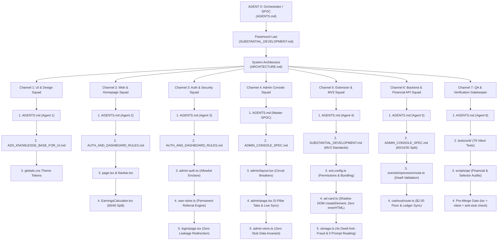

# Agent Network Wiring Framework & Sequential Documentation Tree

> **SINGLE SOURCE OF TRUTH FOR MULTI-AGENT REPOSITORY WIRING**  
> **Target Audience:** All AI Coding Agents (Claude Code, Antigravity Swarm, Cursor, Windsurf, Copilot, Gemini CLI) and Human Contributors.  
> **Status:** Active & Universally Enforced.  
> **Supreme Invariant:** Every agent must traverse the documentation network in the **exact deterministic sequence ("The Perfect Order")** before generating code or opening PRs. Bypassing documentation or pushing unverified changes is strictly forbidden.

---

## 1. Master Network Topology & Wiring Diagram

The diagram below represents the repository's nervous system. The root orchestrator branches into specialized squad channels, each wiring directly into authoritative specifications and code contracts:



---

## 2. Multi-Agent Channel Directories ("The Perfect Order")

Every agent must determine its assigned squad channel and read its documentation sequence before touching files in that domain.

### Channel 0: SPOC Root & Paramount Law
* **Squad Lead:** `AGENT 0: Orchestrator / Master Architect`
* **Domain:** Whole-repository governance, cross-agent dependency management, and architecture.
* **Deterministic Reading Order:**
  1. `AGENTS.md` (Master contract & SPOC)
  2. `SUBSTANTIAL_DEVELOPMENT.md` (Enterprise quality manifesto)
  3. `ARCHITECTURE.md` (System dataflow & subsystems)
  4. `docs/AGENT_NETWORK_TREE.md` (Wiring framework & channel directory)
* **Core Non-Negotiables:**
  - Categorical ban on "rapid prototypes", student hacks, or mock stubs.
  - No commit is made without updating documentation.

---

### Channel 1: UI & Design System Squad
* **Squad Lead:** `AGENT 1: UI & Design Bot`
* **Domain:** `apps/web/app/globals.css`, Tailwind tokens, cards, modals, and container geometry.
* **Deterministic Reading Order:**
  1. `AGENTS.md` (Section 3: Agent 1)
  2. `SUBSTANTIAL_DEVELOPMENT.md` (UI section)
  3. `apps/web/ADS_KNOWLEDGE_BASE_FOR_UI.md` (Design tokens & typography)
  4. `apps/web/app/globals.css` (CSS variables & root theme)
* **Core Invariants:**
  - Background Primary: `#070a0e`, Card Surface: `#0d121c` / `#0c1219`, Border: `#162534`, Accent: Emerald `#10b981`.
  - Desktop container max-width is strictly clamped to `max-w-6xl` (1152px) or `max-w-7xl` with `mx-auto`. Zero stretching on ultra-wide screens.
  - Zero "AI-slop": No neon blobs, no floating purple gradients, no developer jargon in consumer copy.

---

### Channel 2: Web & Homepage Squad
* **Squad Lead:** `AGENT 2: Web & Homepage Bot`
* **Domain:** `apps/web/app/page.tsx`, `Navbar.tsx`, `Footer.tsx`, `HeroChatMockup.tsx`, `EarningsCalculator.tsx`.
* **Deterministic Reading Order:**
  1. `AGENTS.md` (Section 2 & Section 3: Agent 2)
  2. `docs/AUTH_AND_DASHBOARD_RULES.md` (Navbar visibility rules)
  3. `apps/web/app/page.tsx` (Homepage section hierarchy)
  4. `apps/web/components/Navbar.tsx` (Auth-gated nav rendering)
  5. `apps/web/components/EarningsCalculator.tsx` (60/40 revenue split parity)
* **Core Invariants:**
  - The `Dashboard` navbar link beside `Add to Chrome` is **strictly hidden** when unauthenticated, replaced by `Sign in`.
  - The mobile menu drawer mirrors this exact auth-gated behavior.
  - Revenue calculator reflects mathematically exact 60% user earnings / 40% platform take.

---

### Channel 3: Core Auth & User Security Squad
* **Squad Lead:** `AGENT 3: Core Auth & User Security Bot`
* **Domain:** `apps/web/app/login/`, `apps/web/app/dashboard/`, `apps/web/lib/user-store.ts`, `apps/web/lib/admin-auth.ts`.
* **Deterministic Reading Order:**
  1. `AGENTS.md` (Section 2.1 & Section 3: Agent 3)
  2. `docs/AUTH_AND_DASHBOARD_RULES.md` (Route guarding & session state)
  3. `apps/web/lib/admin-auth.ts` (Superadmin allowlist & token verification)
  4. `apps/web/lib/user-store.ts` (Permanent referral engine & account linking)
  5. `apps/web/app/login/page.tsx` (Silent internal routing & zero identity leakage)
  6. `apps/web/app/dashboard/page.tsx` (Protected user rewards console)
* **Core Invariants:**
  - Unauthenticated visits to `/dashboard` or `/dashboard/referrals` **instantly redirect to `/login`**.
  - The public `/login` page must **NEVER** expose admin identity, admin badges, or accounts selector modals.
  - `jhaabhijeet864@gmail.com` silently routes to `/admin`; normal users route to `/dashboard`.
  - Referral codes are permanent and tied to user email.

---

### Channel 4: Admin Command Console Squad
* **Squad Lead:** `AGENT 4: Master Admin Console Bot`
* **Domain:** `apps/web/app/admin/`, `apps/web/app/api/admin/`, `apps/web/lib/admin-store.ts`.
* **Deterministic Reading Order:**
  1. `AGENTS.md` (Master contract & invariants)
  2. `docs/ADMIN_CONSOLE_SPEC.md` (Full admin console specification & invariants)
  3. `docs/AUTH_AND_DASHBOARD_RULES.md` (Section 4: Admin Console Protection)
  4. `apps/web/app/admin/layout.tsx` (Emergency circuit breakers & allowlist gating)
  5. `apps/web/app/admin/page.tsx` (Executive 5-pillar console UI & live sync engine)
  6. `apps/web/lib/admin-store.ts` (Dual telemetry, store sync & audit logs)
* **Core Invariants:**
  - **ZERO STUB DATA INVARIANT:** Never inject fake companies (Cursor, Perplexity), fake users, fake payouts, or fallback fake metric numbers (`450.0`, `1248`, `1842`).
  - Gated exclusively to `jhaabhijeet864@gmail.com`.
  - Continuous 10-second background polling + window focus refresh (no stale metrics).
  - Dual-metric telemetry: CWS installs (with 1-click update/sync modal) + live active extension heartbeat pings.
  - 1-Click Read-Only Impersonation (`/dashboard?device_id=...&impersonate=true`) disables all cashout buttons.
  - Payout settlements require bank UTR reference; rejection automatically refunds the user's balance.

---

### Channel 5: Browser Extension & Adapters Squad
* **Squad Lead:** `AGENT 5: WXT Extension & MV3 Bot`
* **Domain:** `apps/extension/` (WXT Manifest V3, background worker, popup, content scripts, chatbot adapters).
* **Deterministic Reading Order:**
  1. `AGENTS.md` (Section 3: Agent 4)
  2. `SUBSTANTIAL_DEVELOPMENT.md` (Extension & MV3 standards)
  3. `ARCHITECTURE.md` (Section 3: Extension Subsystem Architecture)
  4. `apps/extension/wxt.config.ts` (Manifest permissions & local bundling)
  5. `apps/extension/entrypoints/content/ad-card.ts` (Isolated Shadow DOM construction)
  6. `apps/extension/lib/storage.ts` (Anti-fraud dwell timer & local storage caching)
* **Core Invariants:**
  - Isolated Shadow DOM (`attachShadow({ mode: 'open' })`) with pure DOM APIs (`document.createElement`, `textContent`).
  - **Zero `innerHTML` sinks** and zero dynamic remote scripts.
  - 4-second minimum dwell timer with `document.visibilityState === 'visible'`.
  - **ZERO PROMPT READING:** Query only UI button states (`button[aria-label="Stop"]`); never inspect user queries or AI answers.

---

### Channel 6: Backend & Financial API Squad
* **Squad Lead:** `AGENT 6: Financial Settlement & API Bot`
* **Domain:** `apps/web/app/api/` (`/api/events/impression`, `/api/cashout`, `/api/campaigns`, `/api/referrals`).
* **Deterministic Reading Order:**
  1. `AGENTS.md` (Section 3: Agent 5)
  2. `ARCHITECTURE.md` (Section 4: Backend & Ad Engine Subsystem)
  3. `docs/ADMIN_CONSOLE_SPEC.md` (Financial split & settlement invariants)
  4. `apps/web/app/api/events/impression/route.ts` (Verified dwell criteria & balance credits)
  5. `apps/web/app/api/cashout/route.ts` ($2.00 floor micro-cashouts & payout ledger)
  6. `apps/web/lib/campaign-store.ts` (House ads inventory & budget debits)
* **Core Invariants:**
  - 60% User revenue share / 30% Platform gross profit / 10% Referral reserve.
  - $2.00 minimum cashout floor. Never raise or arbitrarily gate.
  - Rate-limiting on all public endpoints.
  - Instant UPI (India), PayPal (Global), and Gift Card rails.

---

### Channel 7: QA & Verification Gatekeeper Squad
* **Squad Lead:** `AGENT 7: QA, Verification & Pre-Merge Bot`
* **Domain:** `tests/unit/`, `scripts/qa/`, CI workflows (`.github/workflows/ci.yml`).
* **Deterministic Reading Order:**
  1. `AGENTS.md` (Section 3: Agent 6 & Section 5)
  2. `SUBSTANTIAL_DEVELOPMENT.md` (Verification Manifesto)
  3. `tests/unit/api/admin.test.ts` (Admin API & security tests)
  4. `tests/unit/extension/ad-card.test.ts` (Shadow DOM & dwell anti-fraud tests)
  5. `scripts/qa/audit-financials.mjs` (Financial split & ledger math verification)
* **Core Invariants:**
  - All 79+ Vitest tests must pass before merging (`pnpm test`).
  - Monorepo typecheck must pass with 0 errors (`pnpm -r typecheck`).
  - `pnpm --filter @pathixo/web build` must compile cleanly with 0 errors.

---

## 3. Automated Router CLI Commands

Any AI coding agent or human contributor can run the interactive router to inspect the tree, stream documentation, or execute pre-merge gates:

```bash
# 1. View the entire agent network tree & auto-detect active channel
pnpm agent:route

# 2. Stream documents in perfect sequence for a specific channel
pnpm agent:route --channel=admin
pnpm agent:route --channel=ui
pnpm agent:route --channel=auth
pnpm agent:route --channel=ext
pnpm agent:route --channel=api
pnpm agent:route --channel=qa

# 3. Stream full document previews for the auto-detected channel
pnpm agent:route --read

# 4. Validate that all documentation nodes in the tree exist
pnpm agent:verify

# 5. Run the strict Pre-Merge Compliance Gatekeeper (Tests + Typecheck + Anti-Stub Audit)
pnpm pre-merge
```

---

## 4. Cross-Tool AI Agent Directives

Whether an agent is powered by **Claude Code**, **Antigravity**, **Cursor**, **Windsurf**, or **Copilot**, it is pre-configured via repository instruction files:
- **`CLAUDE.md`**: Directs Claude Code to execute `pnpm agent:route` and adhere to channel reading chains.
- **`.cursorrules`**: Automatically informs Cursor / Windsurf to locate the matching channel in `docs/AGENT_NETWORK_TREE.md` before generating code.
- **`.github/copilot-instructions.md`**: Instructs GitHub Copilot to enforce channel boundaries and avoid banned anti-patterns.
- **`AGENTS.md`**: Operates as the master Single Point of Contact (SPOC).
